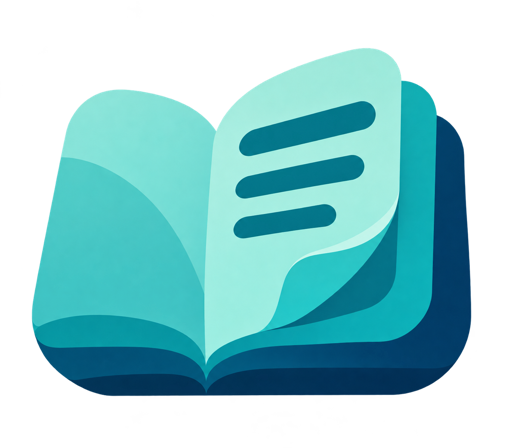
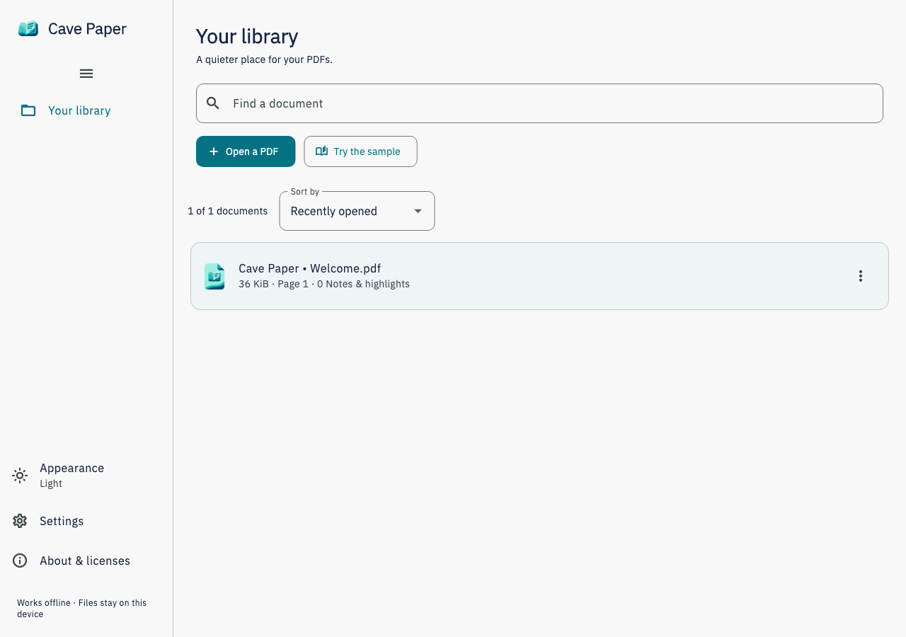
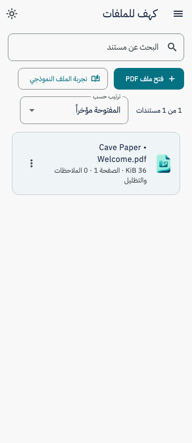

<p align="center">
  
</p>

<p align="center">
  Powered by&nbsp;
  <a href="https://cave.technology"></a>
  &nbsp;<a href="https://cave.technology"><b>Cave</b></a>
</p>

<h1 align="center">Cave Paper</h1>

<p align="center">
  <b>A quiet, private PDF reader. Open source. Offline. No account.</b><br>
  كهف للملفات: قارئ PDF هادئ وخاص، مفتوح المصدر، يعمل دون إنترنت ودون حساب.
</p>

<p align="center">
  <a href="https://github.com/Shmaisanymostafa/paper/actions/workflows/check.yml"></a>
  <a href="LICENSE"></a>
  
</p>

Cave Paper reads, marks up and organizes your PDFs entirely on your device.
There is no account, no server, no ads, no analytics and no tracking. Your
original files are never changed.

<p align="center">
  
  &nbsp;
  
</p>

## Why Cave Paper

- **Private by design.** Works fully offline. Nothing is uploaded, synced or
  measured. See [privacy](docs/PRIVACY.md).
- **Your originals stay untouched.** Highlights and notes are kept beside the
  PDF; saving them into a PDF always creates a new copy.
- **Arabic and English, built in.** Full right-to-left layout and IBM Plex
  fonts bundled in the app.
- **One app, five platforms.** Android, iOS, macOS, Windows and Linux from one
  open-source codebase.
- **Free and open source** under the MIT license.

## Features

- **Read:** smooth scrolling and zoom, page jump, table of contents, text search
  with highlighted results, night pages and a two-page view on wide screens.
- **Mark up:** highlights in six colours, page notes, bookmarks and pen drawing.
  Annotations other apps already put in a PDF are listed too.
- **Save and share:** save a copy with your highlights as standard PDF
  annotations that other readers show; share or print the PDF; export notes.
- **Edit pages:** reorder, rotate, delete, split and merge pages into a new PDF,
  with undo.
- **Organize:** an app library with thumbnails, favourites, reading progress,
  search and sorting; continue where you left off.
- **Fits in:** open PDFs from Files or Finder, Share to Cave Paper on Android,
  password-protected PDFs, light, dark and black themes.

Cave Paper is a reader, not a full PDF editor: it does not edit PDF text or
images, fill and save forms, run OCR, redact or sign. Details in
[development and technical details](docs/DEVELOPMENT.md).

## Download

Cave Paper is in **beta**. The first downloads will appear on the
[Releases page](https://github.com/Shmaisanymostafa/paper/releases) with
SHA-256 checksums. Until then you can build it from source.

## Build from source

Requires Flutter 3.47.6 (Dart 3.13.5), Git and Python 3.9+.

```bash
git clone https://github.com/Shmaisanymostafa/paper.git
cd paper
flutter pub get --enforce-lockfile
python3 tool/check.py        # tests, analysis, formatting and license checks
flutter run -d macos         # or linux, windows, an Android/iOS device
```

Platform toolchains, native tests and release steps are in
[development](docs/DEVELOPMENT.md), [architecture](docs/ARCHITECTURE.md) and the
[release checklist](docs/RELEASE.md).

## Contributing

Bug reports, translations and pull requests are welcome. Read
[Contributing](CONTRIBUTING.md) and the [code of conduct](CODE_OF_CONDUCT.md).
Ask for help through [Support](SUPPORT.md), and report security problems
privately as described in [Security](SECURITY.md).

## License

Cave Paper is released under the [MIT license](LICENSE). It is built on
[pdfrx](https://pub.dev/packages/pdfrx) and Google's PDFium; the IBM Plex fonts
are under the SIL Open Font License. All third-party notices are listed in
[THIRD_PARTY_NOTICES.md](THIRD_PARTY_NOTICES.md) and shown inside the app.

The Cave name and logos identify their owner; the MIT license does not grant
trademark rights. Forks are welcome under a different name.
